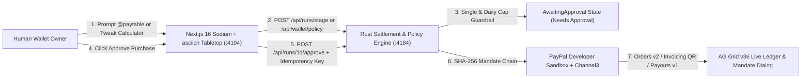
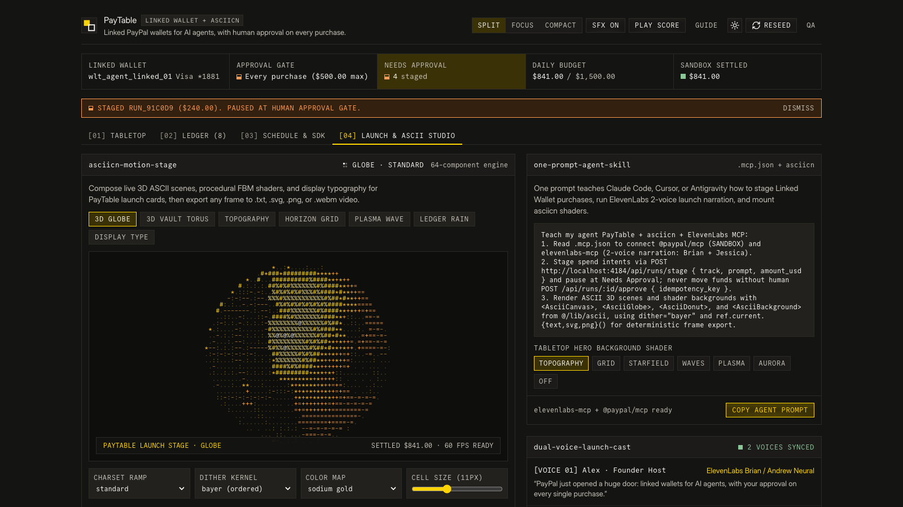

# PayTable v2.0: Linked PayPal Wallets for AI Agents on a Sodium + asciicn Tabletop

PayTable is a collaborative AI commerce tabletop built for **PayPal AI Hackathon: Build What's Next with PayPal and AI**. Inspired by Google Tabletop (`tabletop.google`) and engineered with the **Sodium** infrastructure design system (`design.how/systems/sodium`), **Björk UI** (`ui.isaiahbjork.com`), and **asciicn** (`64` shadcn ASCII shader and 3D scene primitives), PayTable lets people and teams prompt `@paytable` on one shared surface while enforcing **human approval on every linked-wallet purchase** before PayPal Sandbox funds move.

1. **Hosted Live Production Demo**: https://paytable-production-9863f23a.up.railway.app
2. **1-Click Render Cloud Blueprint (`render.yaml`)**: https://dashboard.render.com/blueprint/new?repo=https://github.com/harrymove-ctrl/paytable
3. **v2.0.0 Release & 60 FPS Launch Films**: https://github.com/harrymove-ctrl/paytable/releases/tag/v2.0.0

## What Is New in PayTable v2.0

1. **Interactive 4-Step Onboarding Guide**: A collapsible top-of-tabletop guide (`[01] Pick Track & Set Caps`, `[02] Customize & Stage`, `[03] Approve Every Purchase`, `[04] Mandate & ASCII Export`) teaches new users how every PayPal Linked Wallet workflow operates in seconds.
2. **Live Interactive Calculators Across All 5 PayPal Tracks**: Users can switch vendor quotes, update Single and Daily Linked Wallet caps live (`POST /api/wallet/policy`), calculate `2` to `8` diner receipt shares with custom tip percentages (`15%`, `18%`, `20%`) for PayPal QR invoicing, convert `EUR`, `GBP`, `JPY`, and `CAD` invoices with `4x` Pay Later splits, toggle duplicate-charge Dispute Shields, and adjust community solar pool tiers right on the tabletop.
3. **Built-In Web Audio SFX & Ambient Score (`web/src/lib/sound-engine.ts`)**: Tactile mechanical clicks, stage arpeggios, D-add9 approval chimes, fail-closed guardrail tones, and a toggleable `92 BPM` `D Dorian` generative ambient score bring physical feedback to every action.
4. **Tab `[04] Launch & ASCII Studio` (`asciicn` + `.mcp.json`)**: Ships `7` live `asciicn` modes (`3D Globe`, `3D Vault Torus`, `Topography`, `Horizon Grid`, `Plasma Wave`, `Ledger Rain`, `Display Type`) with Bayer ordered dithering, deterministic frame export to `.txt`, `.svg`, `.png`, and `3s` `.webm` video, plus a copyable **One Prompt Teaches Your Agent** skill card wired to `.mcp.json` (`elevenlabs-mcp` and `@paypal/mcp`).
5. **60 FPS Dual-Voice Kurzgesagt-Inspired Product Launch Film (`video/`)**: Upgraded to `1920x1080` at `60 FPS` (`CRF 17`, `yuv420p`, `-14 LUFS`) featuring two conversational hosts (`Alex` and `Maya`), word-boundary lip-synced 2D rigged characters (`Pip` the Courier Orb-Finch and `Vaulty` the Octagonal Rust Guardian), 3-layer parallax worlds, live `asciicn` 3D shaders, and real captured v2 UI plates (`1:32` Master Launch Film and `0:58` Social Launch Cut).

## Architecture Overview



## Coverage of All 5 PayPal Developer Hackathon Tracks

| Track | PayTable Preset | Interactive Tabletop Controls | PayPal & Sponsor Capabilities Executed |
| :---: | --- | --- | --- |
| `01` | **Linked Wallet Agent Checkout** | 3-merchant quote selector (`$309`, `$289`, `$265`) + live Single (`$500`) and Daily (`$1,500`) wallet cap tuner | Linked Agent Wallet, Channel3 Search, PayPal Orders v2 (`PayPal-Request-Id`), Shipment Tracking v1, `@paypal/mcp` |
| `02` | **Receipt Scan & Dinner Split** | `2` to `8` diner selector + `0% / 15% / 18% / 20%` tip calculator + custom bill subtotal | PayPal Invoicing v2, Scannable Invoice QR Code, Instant Payouts v1 |
| `03` | **Multi-Currency & Creator Split** | `EUR / GBP / JPY / CAD` FX converter + `4x` PayPal Pay Later installment preview | Multi-Currency Invoicing, PayPal Pay Later (`4x`), Subscriptions v1, Batch Payouts v1 |
| `04` | **Budget & Dispute Shield** | Duplicate subscription Dispute Hold toggle (`$29` CloudRender) + custom Request Money link builder | Reporting v1 (`31-day` RFC3339 sanitizer), Payment Links, Disputes v1 Guard |
| `05` | **Neighborhood Solar Co-op Pool** | `$120 / $240 / $360` community contribution presets across `40% / 35% / 25%` cause splits | Donations Checkout, Multi-Cause Split, Recurring Field Payouts v1 |

## Quickstart (Local Setup)

### 1. Start the Rust Settlement & Policy Engine (`:4184`)

```bash
cp .env.example .env.local
cargo test --manifest-path backend-rust/Cargo.toml
cargo run --manifest-path backend-rust/Cargo.toml
```

PayTable operates in two runtime modes:

1. **Live PayPal Sandbox Mode**: Populate `PAYPAL_CLIENT_ID` and `PAYPAL_CLIENT_SECRET` in `.env.local` to execute live OAuth2, Orders v2, Invoicing v2, Payouts v1, and Reporting v1 calls against `https://api-m.sandbox.paypal.com`.
2. **1-Click Judge Sandbox Mode**: With empty credentials, the Rust engine runs deterministic Sandbox state transitions, live wallet policy updates, SHA-256 mandate hashing, and negative error simulations out of the box.

### 2. Start the Next.js 16 Sodium + asciicn Tabletop (`:4104`)

```bash
cd web
npm install
npm run dev
```

Open `http://localhost:4104` (or `http://localhost:4104/?tab=studio` to jump straight to the `asciicn` 3D & Shader Studio, or `http://localhost:4104/?debug=1` for the Adversarial QA guardrail bar).

### 3. Run Automated Verification

```bash
cargo test --manifest-path backend-rust/Cargo.toml
cargo clippy --manifest-path backend-rust/Cargo.toml --all-targets -- -D warnings
cd web && npm run typecheck && npm run build && npx playwright test
```

### 4. Synthesize 2-Voice Narration & Render 60 FPS Launch Films (`1920x1080 @ 60fps`)

```bash
cd video
npm install
npm run voice
npm run render
```

Pass `ELEVENLABS_API_KEY` when running `npm run voice` to synthesize narration via ElevenLabs `with-timestamps` (`Brian` + `Jessica`); when unset, `synthesize_elevenlabs_voice.py` automatically synthesizes expressive dual-host neural audio (`Alex` + `Maya`) with exact millisecond word boundaries. Rendered 60 FPS MP4 files write to `video/out/paytable-hackathon-master.mp4` (`1:32`) and `video/out/paytable-x-launch.mp4` (`0:58`), and pre-rendered 1080p60 MP4 cuts are published on the [v2.0.0 GitHub Release](https://github.com/harrymove-ctrl/paytable/releases/tag/v2.0.0).

## Visual Proof (Sodium Dark, ASCII Studio, Light, and Mobile Viewports)

| Staged at Human Gate + 4-Step Guide | Tab `[04]` Launch & `asciicn` 3D Globe Studio |
| --- | --- |
|  |  |

| Sodium Light Theme (`#ffffff` + `#ffd400`) | Mobile Viewport (`390x844`, `0px` Overflow) |
| --- | --- |
|  |  |

## License

Released under the [MIT License](LICENSE).
