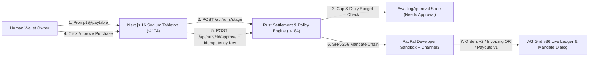
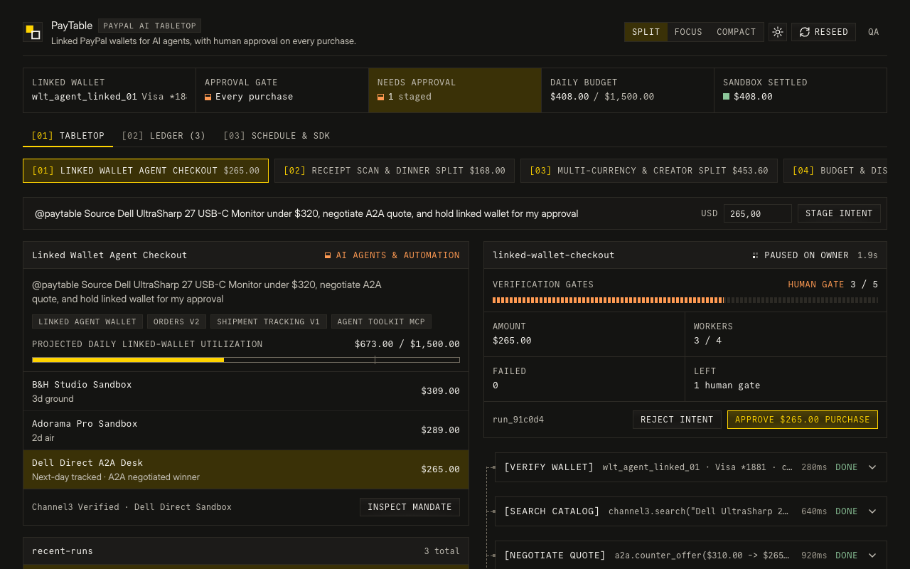
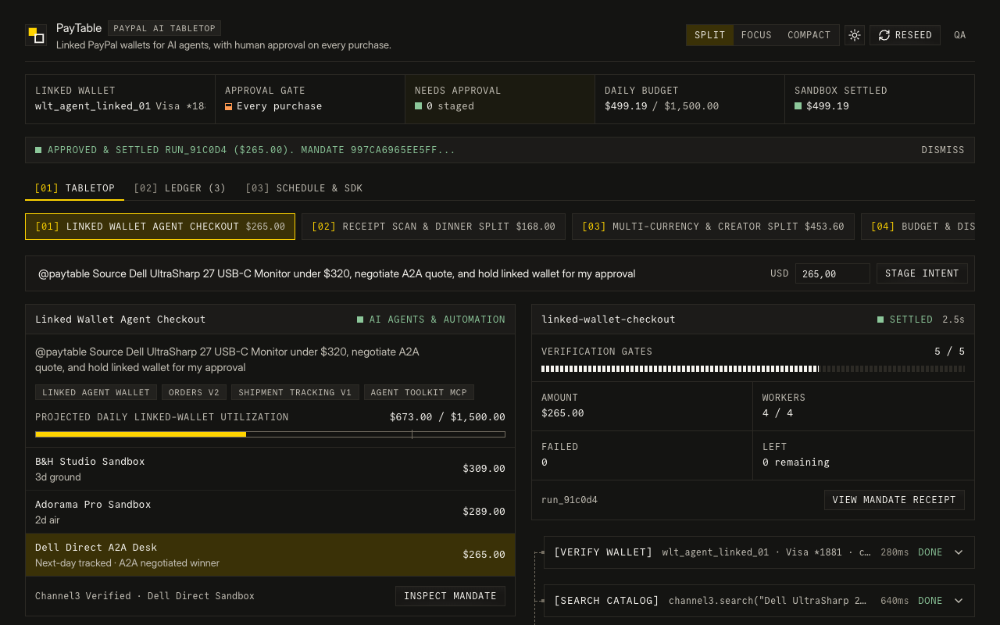
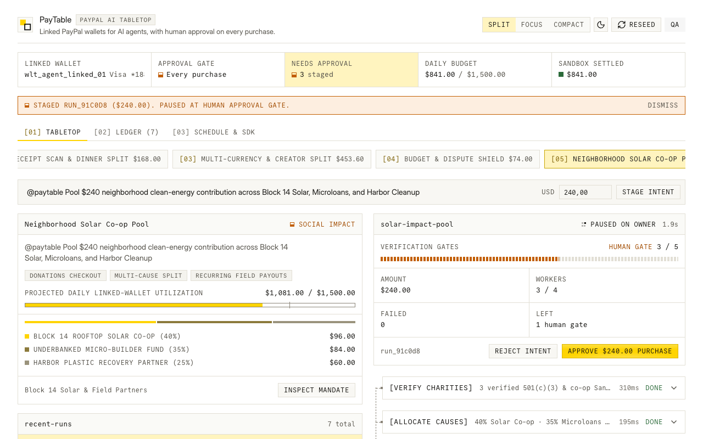
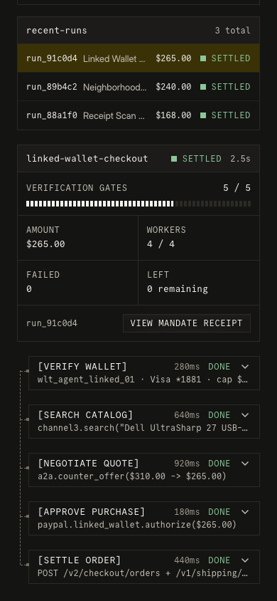

# PayTable: Linked PayPal Wallets for AI Agents on a Minimalist Sodium Tabletop

PayTable is a collaborative AI commerce tabletop built for **PayPal AI Hackathon: Build What's Next with PayPal and AI**. Inspired by Google Tabletop (`tabletop.google`) and engineered with the **Sodium** infrastructure design system (`design.how/systems/sodium`) plus **Björk UI** (`ui.isaiahbjork.com`), PayTable lets people and teams prompt `@paytable` on one shared surface while enforcing **human approval on every linked-wallet purchase** before PayPal Sandbox funds move.

## Why PayTable Exists

PayPal opened linked digital wallets for AI agents so an assistant can shop, split group bills, issue overseas invoices, and disburse payouts without ever seeing raw card credentials. People still need two guarantees before delegating real money to an autonomous agent:

1. **Human Approval on Every Purchase**: Every agent spend intent pauses at a deterministic Rust state gate (`Needs approval`) before any PayPal Orders v2 capture, Invoicing v2 dispatch, or Batch Payouts v1 transfer executes.
2. **One Shared Tabletop Instead of Fragmented Chats**: Groups collaborate inside one minimalist tabletop where procurement quotes, dinner receipt QR splits, multi-currency creator invoices, household budget audits, and community donation pools reconcile live in AG Grid.

## Architecture Overview



## Minimalist Coverage of All 5 PayPal Developer Hackathon Tracks

| Track | PayTable Preset | PayPal & Sponsor Capabilities Executed | Default Tabletop Scenario |
| :---: | --- | --- | --- |
| `01` | **Linked Wallet Agent Checkout** | Linked Agent Wallet, Channel3 Search, PayPal Orders v2 (`PayPal-Request-Id`), Shipment Tracking v1, Agent Toolkit MCP | Searches 3 verified vendors for a Dell UltraSharp 27 monitor, negotiates `$310.00` down to `$265.00`, pauses for owner approval, captures order, and attaches carrier tracking. |
| `02` | **Receipt Scan & Dinner Split** | PayPal Invoicing v2, Scannable Invoice QR Code, Instant Payouts v1 | Parses a `$168.00` 4-diner receipt (Maya, Liam, Noah, Elena), renders a scannable PayPal QR code on the tabletop, and settles shares after host approval. |
| `03` | **Multi-Currency & Creator Split** | Multi-Currency Invoicing (`EUR` to `USD`), PayPal Pay Later (`4x`), Subscriptions v1, Batch Payouts v1 | Bills a Berlin studio `EUR 420.00` (`$453.60`), attaches `4x $113.40` Pay Later, and splits settlement `60%` lead, `30%` motion partner, `10%` platform. |
| `04` | **Budget & Dispute Shield** | Reporting v1 (`31-day` RFC3339 sanitizer), Payment Links, Disputes v1 Guard | Scans 30 days of PayPal transactions, flags a duplicate `$29.00` CloudRender charge for dispute hold, and stages a `$74.00` household Request Money link. |
| `05` | **Neighborhood Solar Co-op Pool** | Donations Checkout, Multi-Cause Split, Recurring Field Payouts v1 | Screen-reader-friendly `$240.00` community pool split `40%` Block 14 Rooftop Solar, `35%` Underbanked Microloans, and `25%` Harbor Cleanup. |

## Design System & Engineering Craft

1. **Sodium Infrastructure UI (`design.how/systems/sodium`)**: Zero border radius (`0px` square geometry), `1px` `--line` structural rules, carbon `#141412` dark theme and `#ffffff` light theme, `Commit Mono` uppercase labels paired with `Inter Display` prose, segmented gate progress cells, one `#ffd400` sodium-yellow primary slab per action group, and `ToolCallStack` rows featuring the native orange `Needs approval` tab.
2. **Björk UI Numeric Precision (`ui.isaiahbjork.com`)**: Strict `tabular-nums` alignment across every balance and metric, gliding numeral transitions on settlement, 1-tap preset staging, and a compact top-right switcher (`Split`, `Focus`, `Compact`, `Dark/Light`, `Reseed`, `QA`).
3. **Fail-Closed Rust Settlement Engine (`backend-rust/`)**: `#![forbid(unsafe_code)]` `axum` + `tokio` service enforcing `$500.00` single-purchase caps (`422 SINGLE_PURCHASE_CAP_EXCEEDED`), `$1,500.00` daily linked-wallet caps, `409 DUPLICATE_APPROVAL_KEY` replay rejection, `502 INSTRUMENT_DECLINED` zero-capture isolation, RFC3339 no-millisecond Reporting window sanitization, and constant-time HMAC-SHA256 webhook verification.
4. **Cinematic Product Demo Film (`video/`)**: Built with Remotion 4.0.539, `Leonxlnx/cinetic` centered kinetic typography, ElevenLabs `eleven_multilingual_v2` voiceover synthesis (`scripts/synthesize_elevenlabs_voice.py` with offline neural voice fallback), modular `D Dorian` score, and mechanical UI foley mastered to `-14 LUFS`.

## Quickstart (Local Setup)

### 1. Start the Rust Settlement & Policy Engine (`:4184`)

```bash
cp .env.example .env.local
cargo test --manifest-path backend-rust/Cargo.toml
cargo run --manifest-path backend-rust/Cargo.toml
```

PayTable operates in two seamless modes:

1. **Live PayPal Sandbox Mode**: Populate `PAYPAL_CLIENT_ID` and `PAYPAL_CLIENT_SECRET` in `.env.local` to execute live OAuth2, Orders v2, Invoicing v2, Payouts v1, and Reporting v1 calls against `https://api-m.sandbox.paypal.com`.
2. **1-Click Judge Sandbox Mode**: With empty credentials, the Rust engine runs deterministic Sandbox state transitions, mandate hashing, and negative error simulations out of the box so judges can evaluate every flow immediately.

### 2. Start the Next.js 16 Sodium Tabletop (`:4104`)

```bash
cd web
npm install
npm run dev
```

Open `http://localhost:4104` (or `http://localhost:4104/?debug=1` to open the Adversarial QA guardrail bar).

### 3. Run Automated Verification

```bash
cargo test --manifest-path backend-rust/Cargo.toml
cargo clippy --manifest-path backend-rust/Cargo.toml --all-targets -- -D warnings
cd web && npm run typecheck && npm run build && npx playwright test
```

### 4. Synthesize Voiceover & Render Demo Videos (`1920x1080 @ 30fps`)

```bash
cd video
npm install
npm run voice
npm run render
```

To synthesize narration with ElevenLabs cloud voices, pass `ELEVENLABS_API_KEY` when running `npm run voice`. Rendered MP4 files write to `video/out/paytable-hackathon-master.mp4` (`1:20`) and `video/out/paytable-x-launch.mp4` (`0:40`), and pre-rendered 1080p MP4 cuts are attached to the [v1.0.0 GitHub Release](https://github.com/harrymove-ctrl/paytable/releases/tag/v1.0.0).

## Visual Proof (Sodium Dark, Light, and Mobile Viewports)

| Staged at Human Gate (`Needs Approval`) | Approved & Settled (`SHA-256 Mandate`) |
| --- | --- |
|  |  |

| Sodium Light Theme (`#ffffff` + `#ffd400`) | Mobile Viewport (`390x844`, `0px` Overflow) |
| --- | --- |
|  |  |

## License

Released under the [MIT License](LICENSE).
